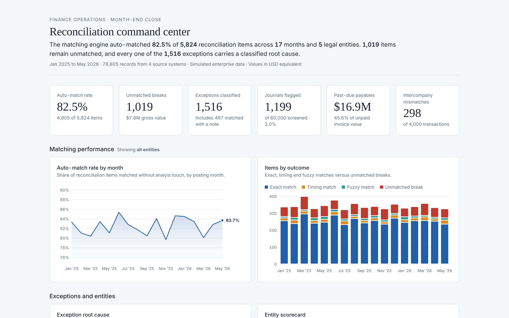
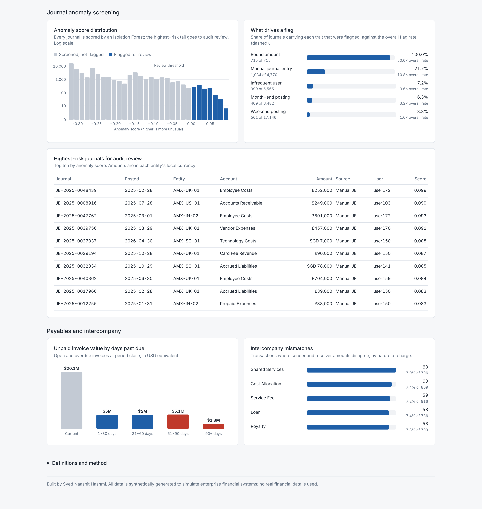

# ClearLedger AI: Financial Reconciliation and Reporting Automation

A Python and SQL project that matches general ledger entries to bank statements, classifies the breaks it can't match, screens journal entries for anomalies with machine learning, and drafts the month-end close report. All data is synthetic (see the note at the bottom).

    

---

## Why this exists

Finance teams spend many analyst-hours each month matching ledger entries to bank statements, chasing down breaks, and writing close commentary. This project automates each of those steps:

| Done by hand today | Done here |
|---|---|
| Analyst matches GL to bank line by line | A three-tier matching engine: exact, then timing, then fuzzy |
| Breaks are investigated one at a time | Each break gets a root-cause label and a one-line rationale |
| Suspicious entries are found by sampling | Isolation Forest scores every journal |
| Close commentary is written manually | A script drafts the management narrative |

On the simulated data the engine auto-matches 82.5% of items. At an assumed 1.5 minutes of manual work per match, that is about 120 analyst-hours saved over 17 months, or roughly 7 a month. All 60,000 journals are screened for anomalies.

---

## Architecture

```
┌─────────────┐   ┌──────────────────┐   ┌───────────────────────┐
│  Data Layer │──▶│ Reconciliation    │──▶│ GenAI Break           │
│  4 datasets │   │ Engine (3-tier)   │   │ Classification (LLM)  │
│  78,605 rows│   └──────────────────┘   └───────────────────────┘
└─────────────┘            │                        │
       │                   ▼                        ▼
       │          ┌──────────────────┐   ┌───────────────────────┐
       └─────────▶│ ML Anomaly       │──▶│ Automated Reporting    │
                  │ Detection        │   │ + Power BI Dashboard   │
                  └──────────────────┘   └───────────────────────┘
```

## Repository structure

```
clearledger-ai/
├── data/                          # Synthetic enterprise datasets
│   ├── general_ledger.csv         # 60,000 GL journal entries
│   ├── bank_statements.csv        # 5,605 bank transactions
│   ├── vendor_invoices.csv        # 9,000 AP invoices
│   └── intercompany_transactions.csv  # 4,000 IC transactions
├── scripts/
│   ├── 01_generate_data.py        # Data simulation
│   ├── 02_reconciliation_engine.py # 3-tier matching algorithm
│   ├── 03_genai_break_classifier.py # LLM-assisted classification
│   ├── 04_anomaly_detection.py    # Isolation Forest screening
│   ├── 05_reporting_automation.py # Close pack generation
│   └── 06_export_dashboard_data.py # Aggregated tables for the dashboard and BI tools
├── sql/
│   └── analytics_queries.sql      # 8 queries (CTEs, window functions)
├── dashboard/
│   ├── clearledger_dashboard.html    # Self-contained interactive dashboard (no server needed)
│   └── data/                      # Dashboard tables (CSV) for Power BI / Tableau import
├── outputs/                       # Generated reports and results
└── docs/
    └── powerbi_guide.md           # Power BI data model and DAX measures
```

---

## How it works

### 1. Reconciliation engine (`02_reconciliation_engine.py`)
Matching runs in three passes, each on what the previous one left over:
- Exact: journal reference, amount and value date all agree.
- Timing: equal amounts within a ±5-day window.
- Fuzzy: amounts within a configurable tolerance, which catches bank charges and partial settlements.

Breaks are found in both directions, so it reports GL-only items and bank-only items.

### 2. Break classification (`03_genai_break_classifier.py`)
The script calls the Claude API with a structured-JSON prompt and sorts each break into one of `TIMING_DIFFERENCE`, `BANK_CHARGES`, `MISSING_IN_GL`, `MISSING_IN_BANK`, `AMOUNT_MISMATCH` or `DUPLICATE_POSTING`. It also writes a one-line rationale an analyst can pick up. Without an API key it falls back to deterministic rules. The results bundled in `outputs/` came from that rule-based path. Set `ANTHROPIC_API_KEY` to use the LLM instead.

### 3. Anomaly detection (`04_anomaly_detection.py`)
An Isolation Forest runs over weekend postings, manual journals, round amounts, rare-user activity and log-scaled amounts. The top 2% by risk score go to audit review, which replaces random sampling.

### 4. SQL library (`sql/analytics_queries.sql`)
- Match-rate trend with month-over-month change using `LAG()`
- Top-N breaks per entity using `ROW_NUMBER()`
- AP aging with running exposure using `SUM() OVER`
- Vendor payment percentile ranking using `PERCENT_RANK()`
- Duplicate payment detection and a weekend manual-journal audit query

### 5. Close reporting (`05_reporting_automation.py`)
One command produces the close pack: a KPI JSON file, AP aging, entity scorecards and a drafted management commentary built from a template that an LLM can fill.

---

## Dashboard





Live version: https://naashit10.github.io/clearledger-ai/dashboard/clearledger_dashboard.html

The interactive version is `dashboard/clearledger_dashboard.html`, a single file you can open in any browser or publish with GitHub Pages. Click an entity in the scorecard to filter the charts, and hover a chart for detail. Money values are USD equivalents at fixed indicative rates.

For Power BI, import the tables in `dashboard/data/` (Get Data, then Text/CSV). [`docs/powerbi_guide.md`](docs/powerbi_guide.md) covers the data model, DAX measures and page layout.

It shows the match-rate trend over 17 months, the distribution of break root causes, a reconciliation scorecard per entity, and AP aging with overdue alerts.

---

## Quick start

```bash
# Clone and install
git clone https://github.com/naashit10/clearledger-ai.git
cd clearledger-ai
pip install pandas numpy scikit-learn

# Run the full pipeline
python scripts/01_generate_data.py        # builds the 78,605-record dataset
python scripts/02_reconciliation_engine.py
python scripts/03_genai_break_classifier.py
python scripts/04_anomaly_detection.py
python scripts/05_reporting_automation.py
python scripts/06_export_dashboard_data.py   # refreshes dashboard/data/*.csv

# Optional: use the live LLM for classification
export ANTHROPIC_API_KEY=sk-...
python scripts/03_genai_break_classifier.py
```

---

## Tech stack

| Layer | Tools |
|---|---|
| Data processing | Python (pandas, NumPy) |
| Matching | Custom three-tier algorithm |
| GenAI | Claude API, with a rule-based fallback |
| Machine learning | scikit-learn Isolation Forest |
| Analytics | MySQL-dialect SQL |
| Visualization | Power BI (star schema, DAX) and an HTML dashboard built with d3 |

---

## Results

| Metric | Value |
|---|---|
| Records processed | 78,605 |
| Auto-match rate | 82.5% |
| Unmatched breaks | 1,019 (800 bank-only, 219 GL-only) |
| Exceptions classified | 1,516 (1,019 unmatched plus 497 matched with a note) |
| Journals screened | 60,000, the full population |
| Anomalies flagged for audit | 1,199 |
| Analyst-hours saved (estimate) | about 120 over 17 months, assuming 1.5 minutes per matched item |

---

## Author

Syed Naashit Hashmi, B.Tech in CS (AI & ML). Published a GenAI paper at ITAI 2025.
[LinkedIn](https://linkedin.com/in/naashithashmi10) · naashith63@gmail.com

All data in this repository is synthetically generated to simulate enterprise financial systems. No real financial data is used.
